# VIT

把图像分割成一系列图像块，每个图像块看作是一个token，再结合位置编码送入transformer encoder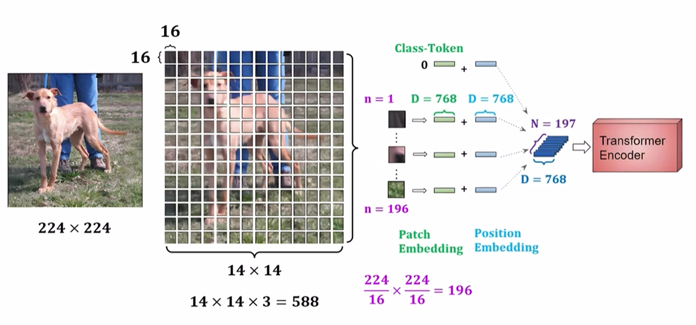

# CLIP

推理过程：让每个图像类别生成一句描述，然后通过文本编码器把每一个描述压缩成文本向量，然后把要预测的图片通过图像编码器得到对应的图像向量，把图片和文字分别编码成向量，然后把它们放到同一个语义空间里比较相似度，去对应文本向量做点积，看谁的结果更高就是哪个类别

1. **image encoder（图像编码器）**：接收图像输入，通过卷积 / Transformer 网络，把图像转化为固定维度的图像 embedding。
2. **text encoder（文本编码器）**：接收文本提示，基于 Transformer，将文本映射为同维度的文本 embedding。
3. **contrastive loss（对比损失）**：训练目标，最大化匹配图文对相似度、最小化不匹配样本相似度，对齐图像与文本表征。不仅要拿图片对应文字算损失，还要拿文字对应图片算损失，最后loss = (loss_i + loss_t) / 2
4. **embedding similarity（嵌入相似度）**：计算图像、文本 embedding 之间距离（常用余弦相似度），用来衡量图文匹配程度，完成检索、零样本分类。


好处

● 利用了丰富的语义作为监督

​	学习到了很多细节语义特征

●将图像和文本进行了连接

​	可以利用文本来查询图像

● 不用预先定义固定类别的标签

​	通过Prompt来查询

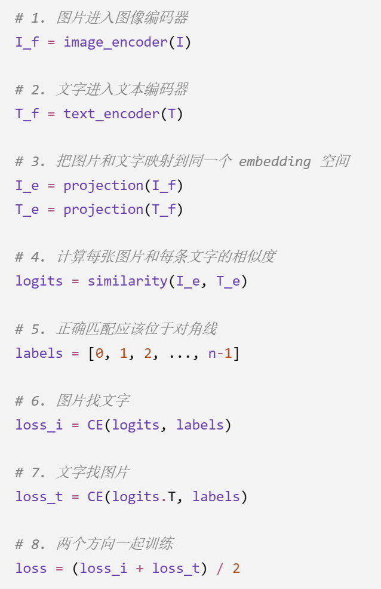

# SAM

分割基础模型，借用prompt来分割实例，这里的prompt不一定是文字，也可能是一个点，一个mask，一个prompt可能会产生不同的对象，那么模型必须得输出所有可能的对象。

==这里如果prompt是文字，就直接使用的是CLIP模型。==

==prompt和image enconder得到的特征拼在一起，经过vit逐一token的计算attention来进行融合==

==focal loss：给容易预测的像素权重低，难分割的权重高==

==dice loss：预测mask和真实mask的重叠度类似LOU，mask交集/mask并集==

c：自动打假：==先用一个有标签的去训练第一版分割的模型，然后再拿这个模型去无标签数据去预测，得到这个数据就有了标签，再拿这个有标签数据去训练模型，还有一个监督网络（有可能是人工监督）去监督每次预测是否正确，就这样不断预测获得到了一个庞大的带标签数据集


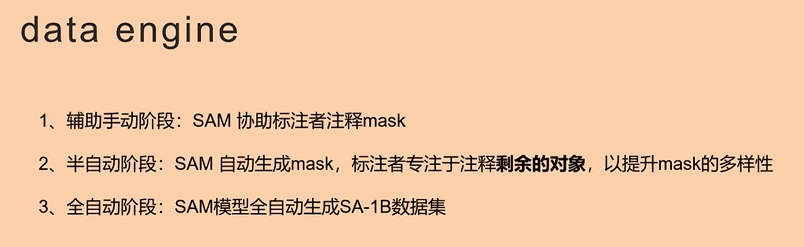

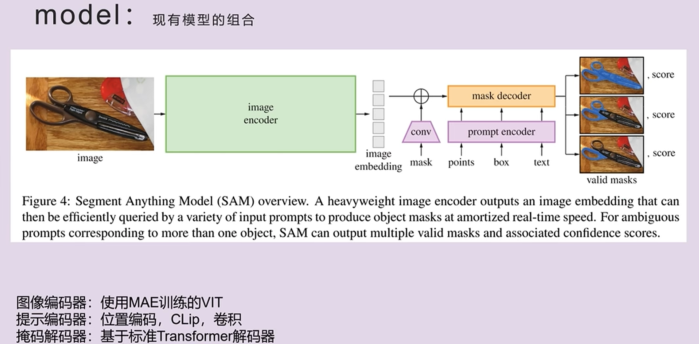1、支持灵活的prompt
2、实时生成mask(图像编码器只运行一次),CPU and 50 ms
3、对于模糊prompt输出valid mask

# DINO

DINO名称源自“Distillation(蒸馏)“与“NO labels(无标签)”,既体现其自蒸馏方法属
性,也凸显无监督核心特点。基于Transformer架构的自监督视觉深度学习模型,核心逻辑为“无监督自蒸馏”:具体通过双分支设计实现 -- 学生分支负责主动学习掌握基础知识表示,老师分支则通过指数移动平均(EMA)跟随学生分支缓慢更新,以保持输出稳定;之后老师分支对无标注图像的输出会作为“伪标签”,学生分支再以靠近这一伪标签为目标重新训练,最终实现性能与泛化能力的提升。

不同于监督学习需人工贴标签,DINO依赖的自监督学习无需显式标签,仅通过图像旋转、随机裁
剪等变换,或图像局部块补全、颜色预测等自预测任务,即可让模型理解图像语义;且能在大规模无标
签数据上训练,既充分利用数据资源,也解决了监督学习依赖标注的瓶颈问题。

student是普通encoder，teacher是momentum encoder

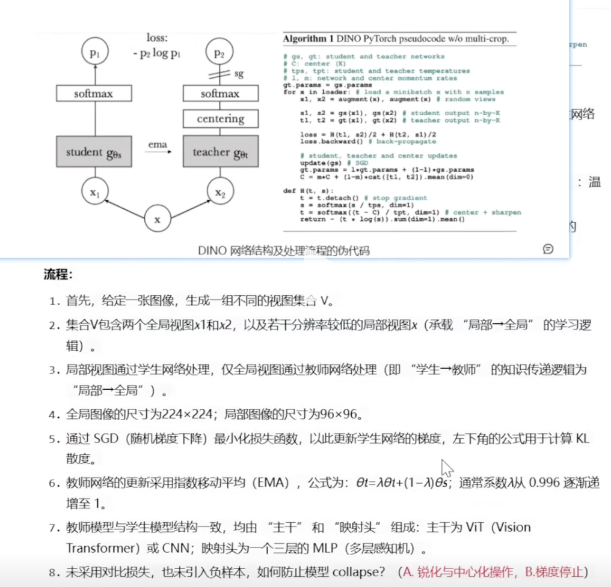

# DINOv2（Distillation with NO labels）

**DINO模型的核心是自监督视觉Transformer**：它通过无标签的自蒸馏机制学习图像特征，适用于各种下游任务，如分类和分割
	**它解决了无标签数据利用的难题**：在数据标注成本高企的背景下，DINO允许模型从海量图像中自动学习表示，减少对人工干预的依赖
	**面向多样化场景**：从通用图像处理到专业领域如卫星遥感，DINO的通用特征在多任务中表现出色，但需注意在极度专业化任务中可能需微调
	**作用显著，但存在争议**：研究表明DINO提升了视觉任务的基准性能，但一些批评者认为其在极低资源环境下的泛化仍有提升空间。

# BERT

在encoder处有三个embedding

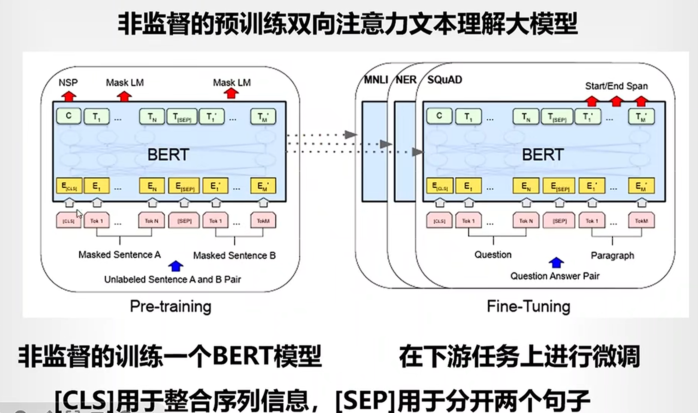

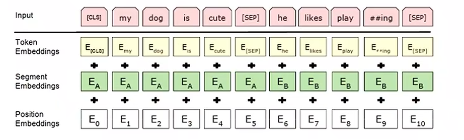

# Open Vocabulary Detection

争对全景分割（语义分割+实例分割） 

**论文：Open-Vocabulary Panoptic Segmentation with Diffusion Model**

利用CLIP模型：强大的鉴别能力

Text2Image Diffusion Model：文本和图像之间细粒度对齐能力

去做开放词汇学习的全景分割任务

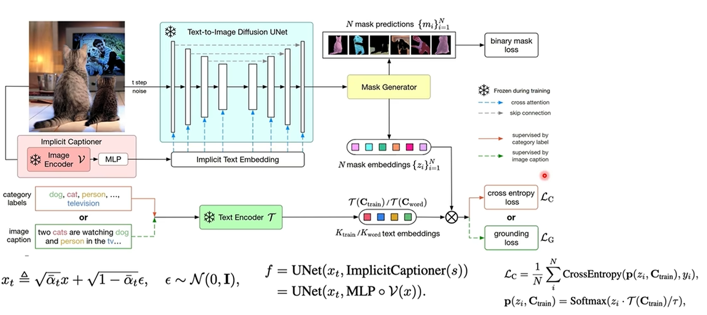

# Grounding DINO（开集目标检测器）

闭集目标检测器:只能检测预先定义的类别的对象。
	开集目标检测器:可以检测指定的任意对象,其关键设计思路是在闭集检测器中引入语言特征。

相比于DINO多了文本的  backbone，提取文本特征

**特点：**

对于图像和语言的处理都使用了transformer架构,处理图像和语言数据更加统一;使得两种模态
的融合更方便,可以很容易地在整个pipeline中融合跨模态特征。
 	以DINO为基础,DINO是一种基于Transformer的检测器,在大规模数据集上有强大的泛化能力。
无需使用NMS等模块,支持端到端训练,极大地简化了模型设计和训练。
	作者提出了一个图像-语言特征深度融合的方案,包括特征增强器、语言引导的查询选择和跨模态解码器。
	Grounding DINO在COCO检测零样本转移基准测试中达到了52.5AP,而在经过COCO数据微调后,达到了63.0 AP。

**总体结构：**

1.对于每个图像-文本对,分别使用图像Backbone和文本Backbone提取图像特征和文本特征,将提取到的特征送入特征增强器模块,用于跨模态特征融合。
	2.在获得跨模态文本和图像特征后,使用语言引导的查询选择模块从特征中选择跨模态查询。这些跨模态查询将被送到跨模态解码器中,从两个模态特征中提取所需的特征并更新自已。最后一层解码器的输出查询将用于预测对象框并提取相应的短语。

这种深度融合策略有效地提升了开集目标检测的性能。

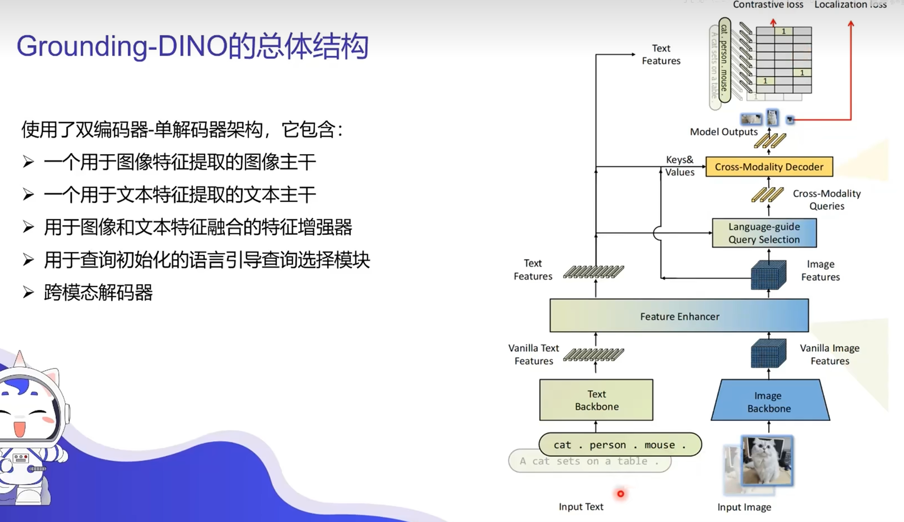

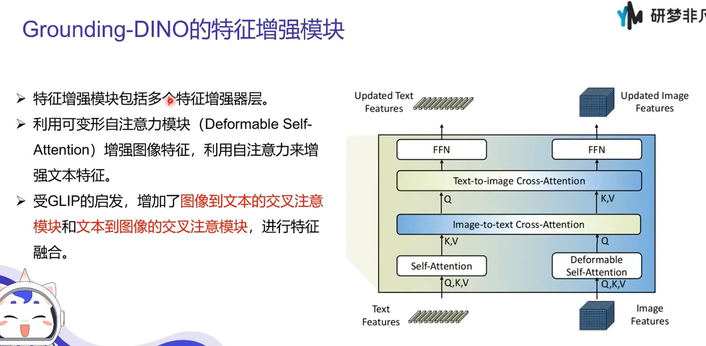

**query初始化：**

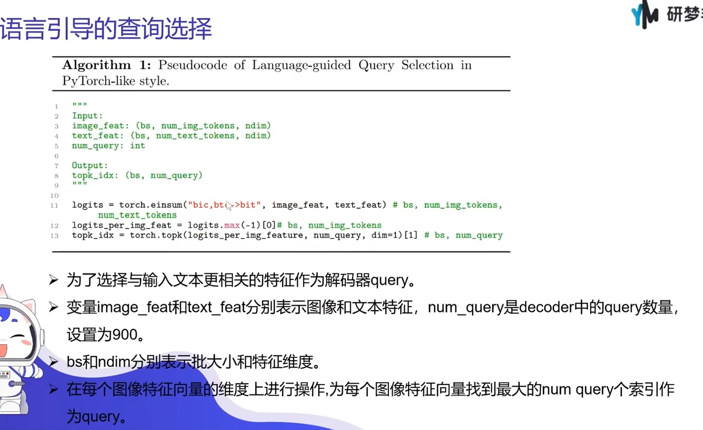

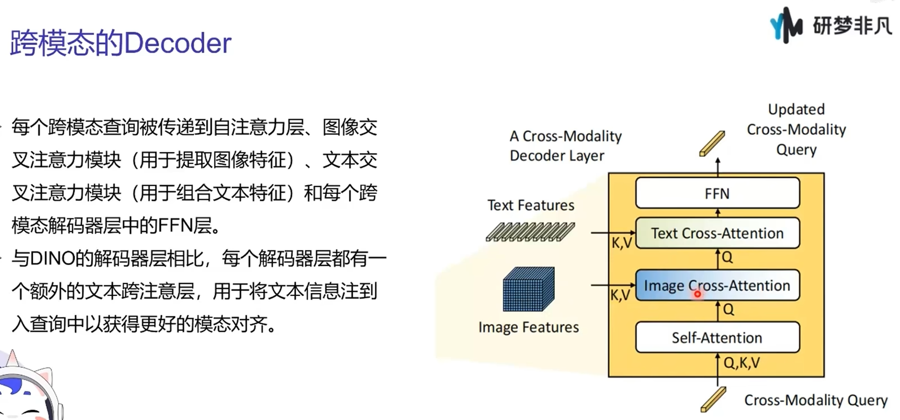

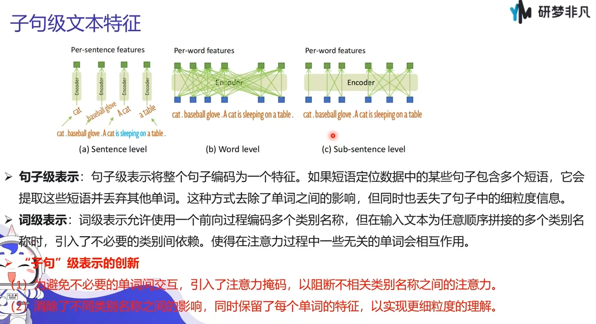

以DINO为基础,提出了GroundingDINO的方法,使得目标检测器具有开集目标检测能力。
	提出了一种紧密融合的方法来更好地融合图像-文本模态信息。
	提出了一种子句级表示,以合理使用文本提示的检测数据。
	将开集对象检测器应用于指代对象检测任务。

## CVA：（Change Vector Analysis变化向量分析）

```
t1像素/特征
      ↓
     差异
      ↑
t2像素/特征
```

如果差异大：

```
Change
```

如果差异小：

```
No Change
```

## ImageDiff

```
t1
 ↓
Image

t2
 ↓
Image

两张图做 Difference
 ↓
差异图
```

## AnyChange:利用 SAM + 特征匹配进行无监督变化检测


# VLM（自监督学习（无监督学习））：

## 基于前置任务：

```
原始图片
   ↓
人为处理
   ↓
得到一个训练任务
```

例如把图片遮住一部分：

```
████████
██🐶███
████████
```

然后让模型：

> “你猜被遮住的是什么。”

这就是一种：

> **Pretext Task / 前置任务**

## 基于对比学习

```
A：狗图片
B：同一只狗增强后的图片

C：汽车
D：房子
E：树
```

C,D,E,均为负样本，加强后的一般是正样本。模型应该：

```
A ↔ B    拉近

A ↔ C    推远
A ↔ D    推远
A ↔ E    推远
```

然后通过相似度计算来算loss。这就是：

> **Contrastive Learning。**
>
> 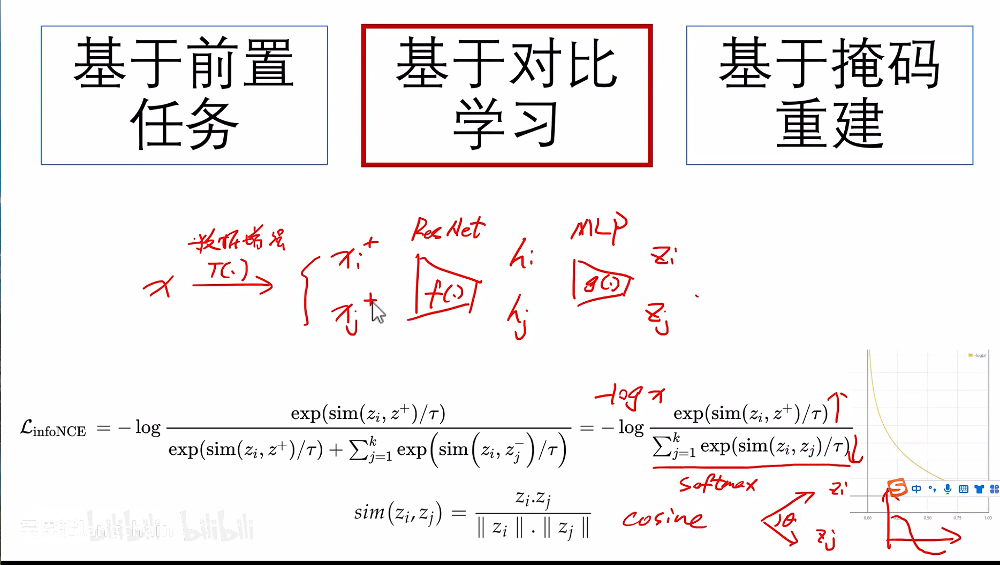
>
> ### 模型1：SimCLR：
>
> ```
> 一张图片
>    ↓
> 两次随机增强
>    ↓
> 两个视图
>    ↓
> Encoder
>    ↓
> 两个Embedding
>    ↓
> 相似度
>    ↓
> Contrastive Loss
> ```

CLIP也是对比学习，CLIP比较的是图片和文字，Simclr比较的是图片和图片

## 模型2：MoCo模型

m是近似1的一个数，特点：用队列的形式排好样本特征，减少计算，动量encoder来更新

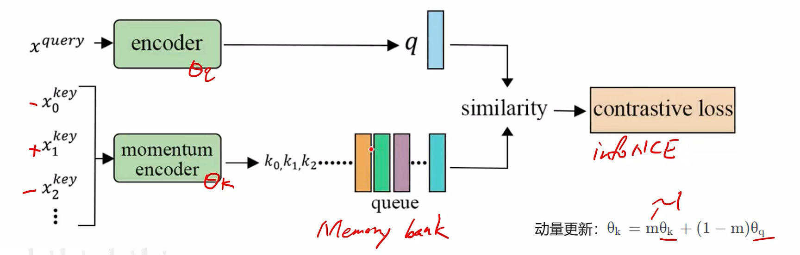

## 基于掩码（mask）重建

mask的好处，比较整张图片变成比较用户指出的一个物体/区域

模型：

> “根据剩下的部分，猜被遮住的内容。”

BEiT：

图片
	 ↓
   随机遮挡
	 ↓
       模型
	 ↓
预测被遮挡部分

                  自监督视觉学习
                         │
          ┌──────────────┼──────────────┐
          ↓              ↓              ↓
       对比学习        掩码重建        自蒸馏
          │              │              │
      SimCLR            BEiT           DINO
          ↓
         MoCo
          ↓
       MoCo v3
          │
          ↓
         ViT

## MAE（Masked Autoencoder掩码自编码器）

              原始图片
                  ↓
              切成Patch
                  ↓
        ┌─────────┴─────────┐
        ↓                   ↓
     随机遮挡              保留
        ↓                   ↓
        ██                Patch
        ██                  ↓
        ██              Encoder(通过transformer去学残缺图片中有用的feature)
                            ↓
                       Visual Feature
                            ↓
                   Decoder（拿到feature和mask token【被掩盖的token】去恢复原来的图片）
                            ↑
                       加入Mask Token
                            ↓
                    重建被遮挡Patch
                            ↓
                           Loss

Encoder负责“看懂剩下的图片”，Decoder负责“根据看懂的内容，把被遮住的图片补回来

```
# 1. 图片切成 Patch
patches = patchify(image)

# 2. 随机遮掉大部分 Patch
visible, mask = random_mask(patches)

# 3. Encoder只看没被遮住的Patch
features = encoder(visible)

# 4. 给被遮住的位置放 Mask Token
features_with_mask = add_mask_token(features, mask)

# 5. Decoder尝试恢复完整图片
reconstructed = decoder(features_with_mask)

# 6. 和原来的图片比较
loss = reconstruction_loss(reconstructed, image)

# 7. 反向传播
loss.backward()
```

# 多模态网络的要素

###### ■ Encoder: 针对每个模态的Encoder（把图片->向量）：

技术：对于图像vit，cnn；对于文本，先进行分词，tokenizer的操作，然后进入文本transformer网络，最后还是转为向量形式

###### ■ Align Strategy: 不同模态的对齐/融合方式

让图像和文本的embedding对齐融合：CLIP

###### ■ LLM(Optional):以大语言模型为核心的网络

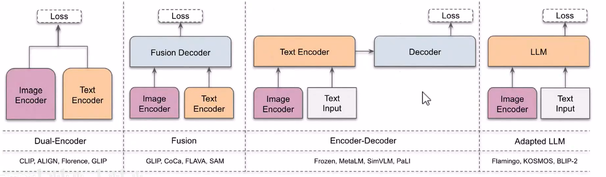