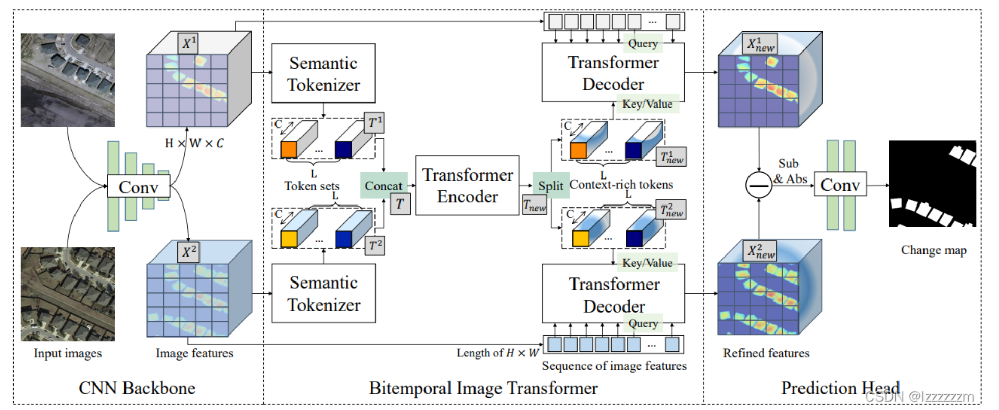

# 遥感论文

CNN/Transformer视觉模型中，feature map的channel数量代表特征种类（feature数量），空间尺寸代表位置信息。Encoder通过降低空间分辨率、增加channel来获得更强语义；Decoder通过增加空间分辨率、调整channel恢复像素级预测。

## 一、MLP是什么？

MLP：**Multi-Layer Perceptron**

中文：**多层感知机**

简单理解：

就是：

> 多层全连接层（Linear层）组成的小网络。

最简单：

```
x = Linear(x)
```

就是一个全连接。

两个：

```
Linear

↓

ReLU

↓

Linear
```

就是MLP。分类网络所做的最后一步全连接（把输出转为分类类别）就是MLP

很多模型：
	Linear Projection
	等价于：1×1卷积。channel要变为x，就把卷积核个数设为x

## Decoder做什么？

三个任务：

------

### （1）恢复空间尺寸

```
8×8

↓

16×16

↓

32×32

↓

256×256
```

让预测结果回到原图大小。

------

### （2）融合不同尺度信息

这是重点。

比如：MiT输出：

```
F1:

64×64

F2:

32×32

F3:

16×16

F4:

8×8
```

Decoder：不是只用F4。

而是：

```
F4
 ↓
融合F3

 ↓
融合F2

 ↓
融合F1

 ↓

输出
```

------

为什么？

F4：知道：“这是建筑”

F1：知道：“建筑边缘在哪里”

结合：才能得到：准确变化区域。

------

### （3）生成像素分类结果

最后：不是输出feature。

而是：预测：每个像素：

变化/不变化。

例如：输出：

```
[batch,2,256,256]
```

两个channel：

```
0:
未变化概率

1:
变化概率
```

## 为什么Transformer里面大量出现MLP？

因为Transformer Block里面本来就有MLP。

一个Transformer Encoder：

结构：

```
Input Token

      |
      |
 Multi-Head Attention

      |
      |
     Add

      |
      |
     Norm

      |
      |
     MLP

      |
      |
     Add

      |
      
Output
```

------

所以：

Transformer不是只有Attention。

实际上：

一个Transformer Block：

= Attention

- 

MLP

#### 为什么Attention后还需要MLP？

Attention做什么？

主要：建立关系。

例如：

这个建筑区域：

应该关注：另一个区域。

但是Attention本身：

主要做信息交换。

MLP负责：

进一步变换特征。

类似：

Attention：

“交流信息”

MLP：

“加工信息”

## 孪生网络Siamese Network

孪生网络其实主要有两种形式，**一种为共享权重的一种为不共享权重的**。

###### 全卷积孪生网络的Feature fusion为什么不足？

简单的特征拼接无法有效选择不同尺度特征中的重要信息，可能引入噪声特征，导致浅层细节和深层语义之间存在融合冲突。所以很多论文提出：Attention fusion让网络学习：哪些feature应该被关注。

###### 小目标漏检原因：

1. 下采样导致目标消失
2. 深层feature更关注大目标语义
3. 类别不平衡（变化区域通常很少）

> 由于连续下采样导致小目标空间信息被压缩，同时深层特征更加关注高层语义，大量小尺度变化区域难以保留。

| 问题       | 可能创新                   |
| ---------- | -------------------------- |
| 边界丢失   | 边界增强、SAM              |
| 融合不足   | Attention、Cross Attention |
| 小目标漏检 | 多尺度、超分辨率           |
| 单模态不足 | RGB+SAR+DEM                |

---

| 问题           | 原因         | 方法             |
| -------------- | ------------ | ---------------- |
| 边界模糊       | 空间细节不足 | SAM、边界增强    |
| 小目标漏检     | 下采样损失   | 多尺度、HR结构   |
| 季节变化误检   | 单模态不足   | RGB+SAR+DEM      |
| 长距离关系不足 | 局部建模     | Transformer      |
| 融合效果差     | 特征选择不足 | Attention Fusion |

###### num_workers = 读数据的并行程度（`num_workers` 是 **DataLoader 读取数据时开几个“后台进程”帮你加载图片**）

不是模型参数
	不影响最终精度
	只影响速度和稳定性

## BIT：

**诱因：**传统孪生网络效果不够好

**流程**：使用cnn的resnet进行编码，再压缩为token进行 特征融合，再使用decoder解码

**不足**：使用cnn进行特征压缩时会造成边缘信息容易丢失，压缩为token更容易丢失信息，BIT虽然引入Transformer进行特征交互，但其前端仍依赖CNN提取特征，CNN受限于局部感受野，难以充分捕获长距离空间依赖，缺少全局信息关系建立；BIT虽然利用Transformer增强双时相关系建模，但CNN backbone限制了全局特征提取能力，同时token压缩过程可能造成空间细节损失。因此ChangeFormer尝试直接利用Transformer进行多尺度特征提取和融合。

**bit结构图：**



---

# ViT（Vision Transformer）是什么？

> ViT就是把图片切成很多小块，然后把每个小块当成一个token送进Transformer。

过程：

图片

↓

切patch

↓

Patch Embedding

↓

token1
	token2
	token3
	...

↓

Transformer

↓

输出特征

==问题：切成的batch尺寸一样大，没有多尺度，普通ViT虽然具有强大的全局建模能力，但固定patch划分方式削弱了空间层次信息，不利于遥感变化检测中的多尺度目标识别。==

# 为什么ViT比CNN有更强的全局建模能力？

Transformer：Self-Attention：

任意两个token之间可以直接计算关系。

例如：左上角建筑：

可以直接关注：右下角道路。

数学：Attention(Q,K,V)

计算：Query和所有Key的关系。

所以：

CNN通过局部卷积逐渐扩大感受野，而Transformer通过Self-Attention直接建立任意位置之间的长距离依赖。

# 六、MiT是什么？

MiT：

全称：**Mix Transformer**

可以理解：融合CNN多尺度思想的Transformer。

它是：Mix Transformer (MiT)里面的核心Encoder。

## MiT：

类似：CNN金字塔。

输出：多个尺度。

例如：

Stage1：

```
64×64
```

Stage2：

```
32×32
```

Stage3：

```
16×16
```

Stage4：

```
8×8
```

------

也就是说：

MiT：

既有：

Transformer全局能力。

又有：

CNN多尺度能力。

### Changeformer:

特点：强调使用多尺度，才能结合图像的所有尺寸的特征信息

decoder:负责将Encoder提取的高级语义特征重新映射到像素空间，同时融合不同尺度的信息，使模型能够准确定位变化区域。

## UNet：

Decoder主要：

```
恢复空间
+
skip connection融合
```

------

## ChangeFormer：

传统CNN-based decoder主要依赖局部卷积进行特征融合，难以有效建模遥感影像中长距离空间依赖关系。ChangeFormer利用Transformer Decoder通过自注意力机制实现多尺度特征以及双时相特征之间的全局交互，从而提升复杂场景下变化区域的识别能力。

Decoder：

```
恢复空间
+
多尺度Transformer特征融合
+
双时相变化信息融合
```

# . Transformer Decoder负责什么？

> **融合不同尺度的Transformer特征，并进一步建模双时相变化关系。**

------

我们回忆一下：

MiT Encoder输出：

假设：

时间1：

F11,F21,F31,F41

时间2：

F12,F22,F32,F42

其中：

F1：高分辨率，细节多。

F4：低分辨率，语义强。

------

Transformer Decoder做什么？

```
F4
 |
融合
 |
F3
 |
融合
 |
F2
 |
融合
 |
F1
```

同时：利用Attention：

学习：哪些区域之间关系重要。

例如：

时间1：这里是建筑。

时间2：这里变成空地。

Attention：帮助模型理解：这是变化。

------

所以：更准确：

Transformer Decoder负责对Encoder输出的多尺度特征进行注意力融合，增强不同区域之间的关系建模能力，注意，和unet不一样，changeformer的decoder融合的是encoder之后==输出的特征图==

## 第一步：Feature Relation

Transformer：

学习：

两个时间feature之间关系。

------

## 第二步：Feature Projection

MLP：

统一feature维度。

------

## 第三步：Spatial Recovery

Upsample：

恢复空间大小。

### 为什么连接层和上采样层要分开？

它们解决不同问题。

1. Linear / MLP

解决：通道维度问题。

Encoder输出：

F1:64×64×64


F2:32×32×128


F3:16×16×320


F4:8×8×512

融合之前：

channel不一样。

不能直接加。

MLP：统一channel。

例如：全部变：256。

2. Upsampling

解决：空间尺寸问题。

例如：

F4：8×8不能直接和：F1：64×64融合。

所以：上采样：

8×8

↓

64×64

​     模块		  解决什么
​	    MLP		    通道数
​	Upsample	      宽高
​	Transformer       关系建模

图片先经过卷积得到不同的特征图，这里通道数一定会改变，因为特征图个数对应就是通道数个数；在decoder里，不断上采样时，也会融合更小的特征图再进行上采样来保留边缘信息，F4先进行MLP改变通道数，再用upsample改变长宽，F3也要利用MLP改变通道数，此时通道数和长宽大小都一致才能进行拼接，上采样时既要利用上采样改变长宽，也要利用mlp改变通道数个数才能进行残差连接。

### ChangeFormer Decoder流程

##### Encoder：

              Image
    
                |
                ↓
    
             MiT Encoder


      F1        F2        F3        F4

   64×64    32×32    16×16     8×8

##### unetDecoder直接使用encoder产出的特征图：

F4

↓

MLP //改变特征图个数，通道数

↓

Upsample//再改变长宽，这里得到D4

↓

       + F3//经过上采样后的F3
          |
          | 
          ↓
    
      Decoder Stage//融合后再进行MLP这里得到D3


↓

Upsample

↓

       + F2


↓

Upsample

↓

       + F1


↓

Prediction

##### ChangeFormer MLP Decoder：

all features are projected to the same dimension and fused together，所有尺度：先变成一样大小。再融合。

F1 ──MLP──Upsample──┐
                    |
	F2 ──MLP──Upsample──┤
                    |
	F3 ──MLP──Upsample──┤
                    |
	F4 ──MLP──Upsample──┘

          ↓
    
      Feature Fusion
    
          ↓
    
      Prediction

###### 代码：

输出预测图的流程：

模型原始输出：
[batch_size, 2, H, W]
每个像素有 2 个分数，变化的和未变化的分数

argmax 后：
[batch_size, 1, H, W]
每个像素只剩类别 0/1，变化后的分数大，那么把变化后的染成白色，未变化的分数大，原图不变

乘 255 后：
[batch_size, 1, H, W]
0 变黑，1 变白

for 循环：
逐张取出 batch 里的预测图

pred[0]：
去掉单通道维度，变成 [H, W]

.cpu()：
确保数据在 CPU 内存

.numpy()：
转成 NumPy 数组

save_image：
保存成 png

深度学习模型通常按 batch 输出结果。变化检测模型先输出每个像素属于各类别的分数，再用 argmax 转成类别图。这里类别 0 表示未变化，类别 1 表示变化。为了保存成黑白 png，把 0/1 乘以 255，得到 0/255。由于 batch 里可能有多张图，所以 for 循环逐张保存。保存前要去掉通道维，把 tensor 放到 CPU，再转成 numpy 数组。


